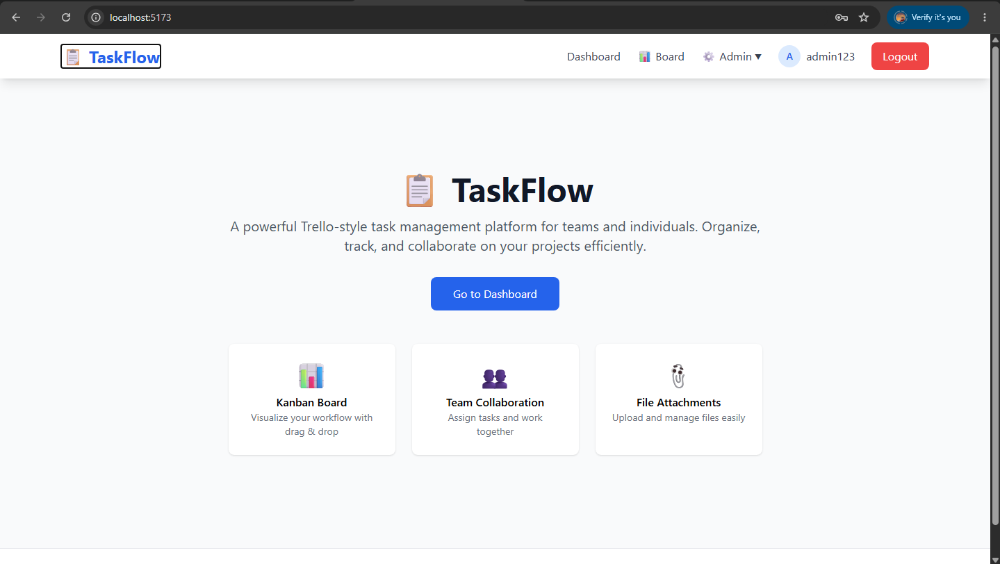
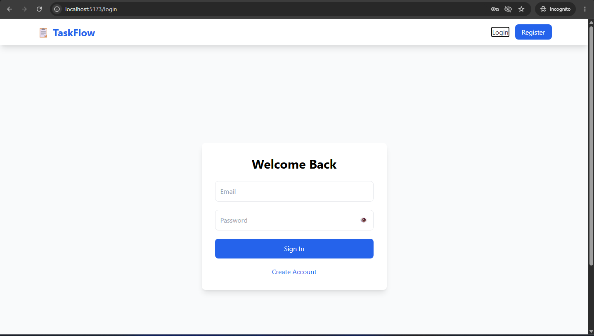
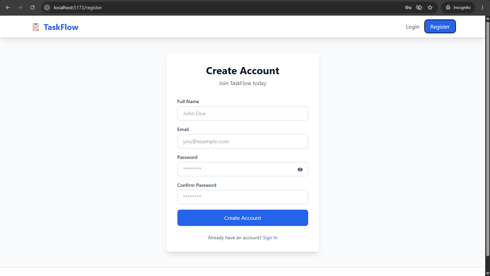
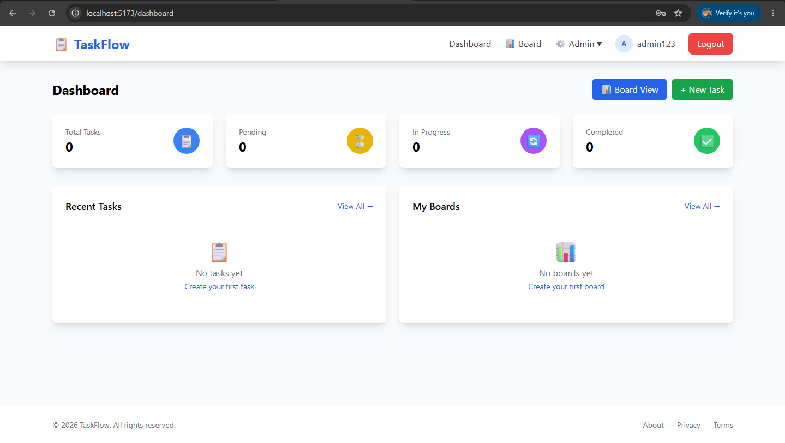
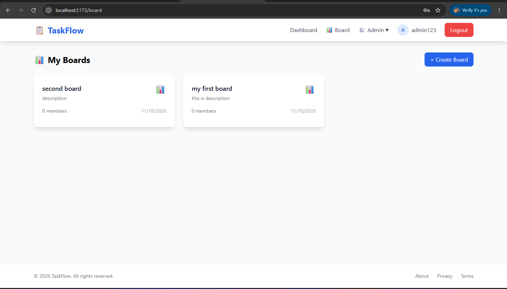
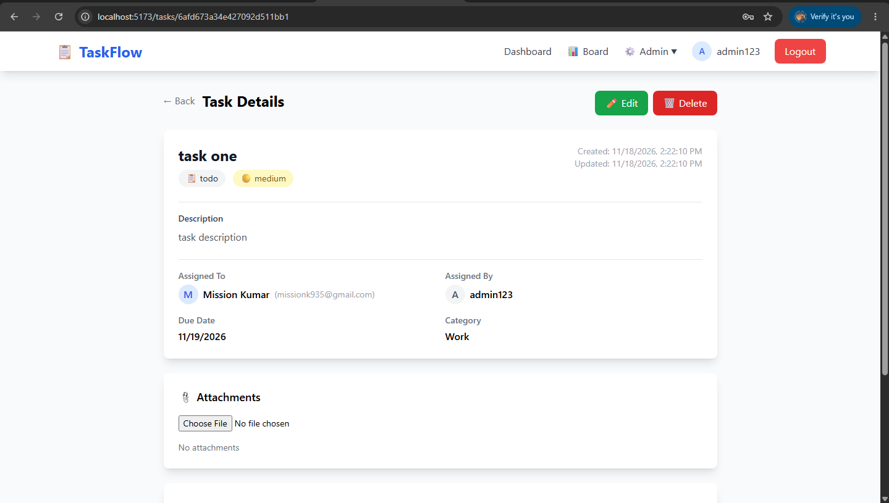
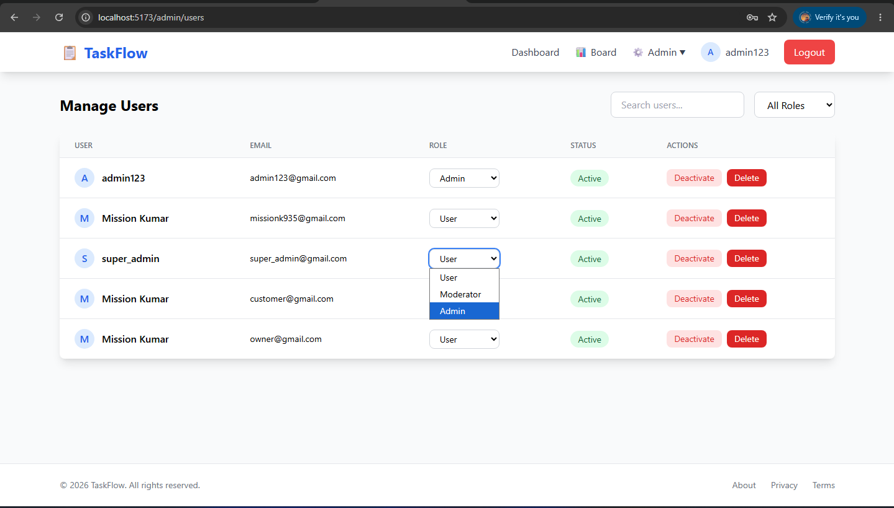
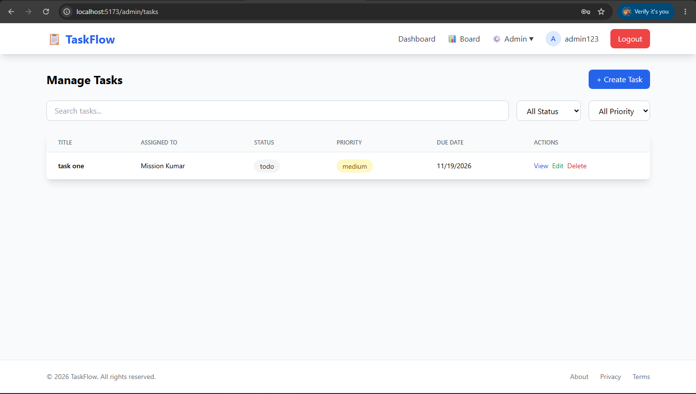
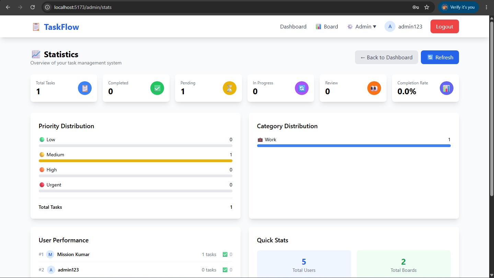
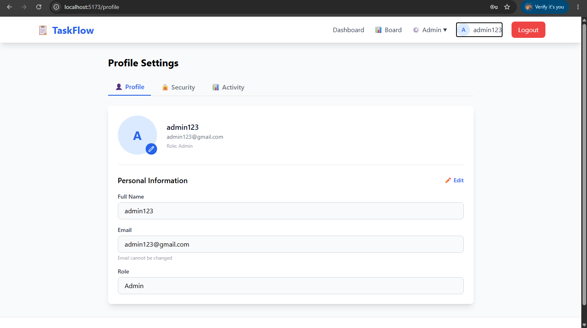

Aap is pure code ko copy karein aur apni README.md file mein paste kar dein:

markdown
# 📋 TaskFlow - Trello-Style Task Management Platform

A powerful, collaborative task management platform designed for teams and individuals. Organize your workflow, track progress, and collaborate seamlessly using Kanban boards, role-based access control, file attachments, and detailed statistics.

## 🚀 Project Repository
[GitHub Repo](https://github.com/missionkuamar/TaskFlow) *(Apna actual repository link yahan daalein)*

---

## 📸 Screenshots

### 🏠 Authentication & Landing Page




### 📊 User Dashboard & Boards




### 📝 Task Details & Management


### 🛡️ Admin Panel & Statistics





---

## ✨ Features (Detailed)

### 👤 Role-Based Access Control (RBAC)
- **Super Admin / Admin**: Complete access to the platform. Can manage users (change roles, deactivate, delete), view all tasks, manage boards, and view system statistics.
- **Moderator**: Can manage tasks, view users, and moderate content.
- **User**: Can create personal boards, manage tasks, assign tasks, and collaborate with team members.

### 📌 Kanban Board System
- Create multiple boards with custom titles and descriptions.
- Visual workflow using Drag & Drop functionality.
- Default columns: **To Do**, **In Progress**, **Review**, and **Done**.
- Track board members and creation dates.

### 📝 Task Management
- Create tasks with title, description, and due date.
- Assign priority levels: **Low**, **Medium**, **High**, **Urgent**.
- Assign tasks to specific team members.
- Categorize tasks (e.g., Work, Personal, etc.).
- Upload and manage file attachments for tasks.
- View detailed task history (Created by, Assigned to).

### 📊 Admin Dashboard & Statistics
- Overview of Total Tasks, Completed Tasks, Pending Tasks, and Completion Rate.
- Visual analytics for **Priority Distribution** (Low, Medium, High, Urgent).
- Visual analytics for **Category Distribution**.
- User performance tracking (tasks assigned and completed).
- Manage all users directly from the admin panel.

### 🔒 Security & Authentication
- Secure login and registration system.
- Protected API routes using JWT (JSON Web Tokens).
- Profile management with editable personal information and secure passwords.

---

## 🛠️ Tech Stack

### Frontend
- **React.js (Vite)** - UI Library
- **Tailwind CSS** - Styling & Responsive Design
- **React Router DOM** - Client-side Routing
- **Axios** - API Requests
- **React Hot Toast** - Notifications

### Backend
- **Node.js + Express.js** - Server & REST API
- **MongoDB & Mongoose** - Database
- **JWT (JSON Web Tokens)** - Authentication
- **Bcrypt.js** - Password Hashing
- **Multer** - File Uploads (Task Attachments)

### DevOps & Deployment
- **Docker & Docker Compose** - Containerization
- **GitHub Actions** - CI/CD (if configured)

---

## 📁 Project Structure

```text
taskflow/
├── client/                  # React Frontend
│   ├── public/              # Static assets & Screenshots
│   ├── src/
│   │   ├── components/      # Reusable UI (Navbar, Sidebar, Modals)
│   │   ├── pages/           # Home, Dashboard, Board, Admin, Profile
│   │   ├── store/           # State Management (Redux/Context)
│   │   ├── utils/           # API calls, helpers
│   │   └── App.jsx
│   ├── .env                 # Frontend Environment Variables
│   └── package.json
├── server/                  # Node.js Backend
│   ├── config/              # DB connection
│   ├── controllers/         # Auth, Tasks, Boards, Users, Stats
│   ├── middleware/          # Auth & Role checks
│   ├── models/              # MongoDB Schemas (User, Task, Board)
│   ├── routes/              # API Endpoints
│   ├── .env                 # Backend Environment Variables
│   ├── Dockerfile
│   └── package.json
├── .github/                 # GitHub Actions workflows
├── docker-compose.yml       # Multi-container setup
└── README.md
⚡ Installation & Setup
1. Clone the Repository
bash
git clone https://github.com/missionkuamar/TaskFlow.git
cd TaskFlow
2. Backend Setup (server folder)
bash
cd server
npm install
Create a .env file in the server folder and add the following variables:

env
# Server Configuration
PORT=5000
NODE_ENV=development

# Database
MONGODB_URI=mongodb://localhost:27017/taskflow

# Authentication
JWT_SECRET=your_super_secret_jwt_key

# URL Configuration
CLIENT_URL=http://localhost:5173
Start the backend server:

bash
npm run dev
3. Frontend Setup (client folder)
Open a new terminal and navigate to the client folder:

bash
cd client
npm install
Create a .env file in the client folder and add the following variables:

env
# API & Backend URLs
VITE_API_URL=http://localhost:5000/api
VITE_BACKEND_URL=http://localhost:5000
Start the frontend server:

bash
npm run dev
4. Access the Application
Open your browser and visit: http://localhost:5173

🔑 Environment Variables Explained
Yahan dono .env files ke variables ka detail diya gaya hai:

🖥️ Server .env Variables
Variable	Description	Example
PORT	The port on which the backend server runs.	5000
NODE_ENV	Environment mode (development/production).	development
MONGODB_URI	Your MongoDB connection string (Local or Atlas).	mongodb://localhost:27017/taskflow
JWT_SECRET	Secret key used to sign JWT authentication tokens.	your_super_secret_key
CLIENT_URL	URL of the frontend (for CORS configuration).	http://localhost:5173
💻 Client .env Variables
Variable	Description	Example
VITE_API_URL	The base URL for all API requests (includes /api).	http://localhost:5000/api
VITE_BACKEND_URL	The base URL for the backend server (without /api).	http://localhost:5000
🔌 API Endpoints (Overview)
Authentication (/api/auth)
text
POST   /api/auth/register      - Register a new user
POST   /api/auth/login         - Login user & get token
GET    /api/auth/profile       - Get logged-in user profile
PUT    /api/auth/profile       - Update user profile
Boards (/api/boards)
text
GET    /api/boards             - Get all user boards
POST   /api/boards             - Create a new board
GET    /api/boards/:id         - Get single board details
PUT    /api/boards/:id         - Update board
DELETE /api/boards/:id         - Delete a board
Tasks (/api/tasks)
text
GET    /api/tasks              - Get all tasks (Admin view)
POST   /api/tasks              - Create a new task
GET    /api/tasks/:id          - Get task details
PUT    /api/tasks/:id          - Update task (status, priority, etc.)
DELETE /api/tasks/:id          - Delete task
Admin (/api/admin)
text
GET    /api/admin/users        - Get all users
PUT    /api/admin/users/:id    - Update user role
DELETE /api/admin/users/:id    - Delete a user
GET    /api/admin/stats        - Get platform statistics
🐳 Running with Docker
If you prefer to run the project using Docker, follow these steps:

bash
# Ensure Docker Desktop is running
docker-compose up --build
This will start both the frontend and backend containers. Access the app at http://localhost:5173.

🚀 Deployment
Backend (Render / Railway)
Push your code to GitHub.

Connect your repository to Render.

Add all the server .env variables in the Render dashboard.

Set Build Command: npm install and Start Command: npm start.

Frontend (Vercel / Netlify)
Run npm run build in the client folder.

Deploy the dist folder to Vercel/Netlify.

Add all the client .env variables in the deployment dashboard.

Ensure the VITE_API_URL points to your live backend URL.

📦 Key Dependencies
Backend:

text
express, mongoose, bcryptjs, jsonwebtoken,
cors, dotenv, multer
Frontend:

text
react, react-router-dom, axios, tailwindcss, react-hot-toast
📄 License
MIT License

👨‍💻 Author
Mission Kumar

GitHub: @missionkuamar

Repository: TaskFlow

⭐ Star this repository if you found it helpful!

text

---
**Aapka folder structure bahut clean hai!** Jaisa aapne `.github`, `docker-compose.yml`, aur `.env` files rakhi hain, usse pata chalta hai ki project production-ready hai. Agar aapko GitHub Actions (CI/CD) ka koi specific setup bhi add karna ho README mein, toh bata dena!